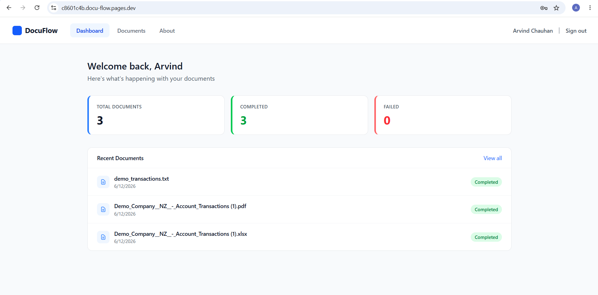
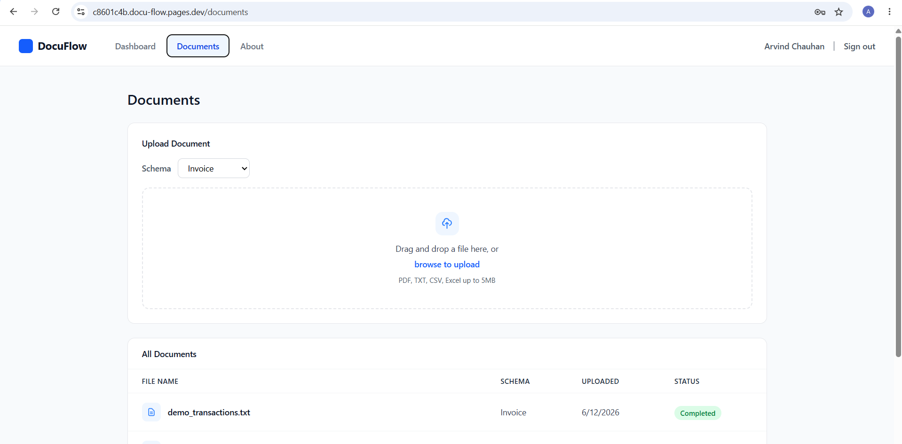
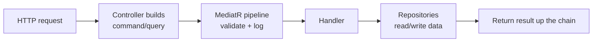
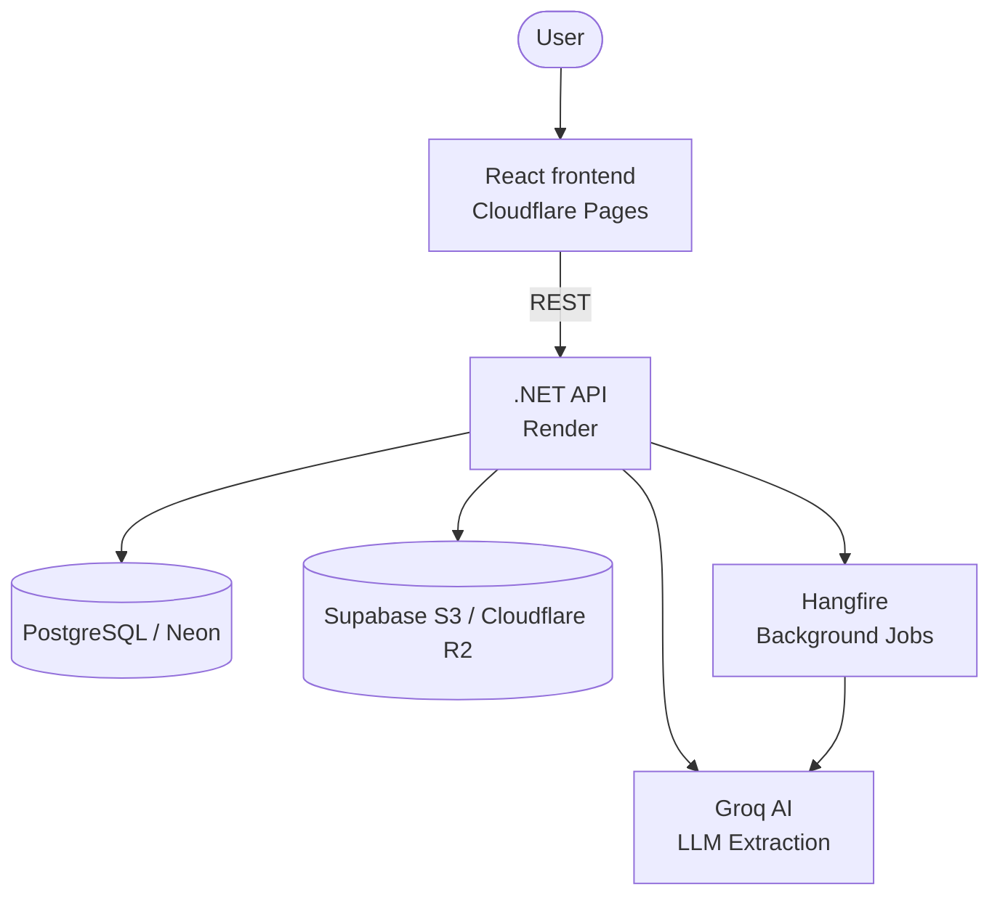

```markdown
# DocuFlow

**Turn documents into structured data.** Upload an invoice, contract, receipt, or spreadsheet and DocuFlow extracts the fields you care about — automatically, in the background, with a confidence score on every value.

### 🔗 [Try the live demo →](https://docu-flow-9p7.pages.dev)

> **Note:** The demo backend hosted on Render spins down when idle (to keep free-tier costs at zero), so your **very first request may take ~10 seconds** while the service spins back up. Subsequent requests run fast.

|                                                |                                                              |
| ---------------------------------------------- | ------------------------------------------------------------ |
|     |  |
| _Your documents — with live processing status_ | _Drag-and-drop upload_                                       |

---

## What is this?

Imagine you have a pile of paperwork — invoices, contracts, receipts — and someone has to read each one and type the important bits into a system. DocuFlow automates that end-to-end:

1. **Upload** a document (PDF, TXT, CSV, or Excel).
2. **Wait a moment** while it's processed in the background.
3. **Get structured data back** — the fields defined by a schema (e.g. an invoice's number, date, total), each with a **confidence score** telling you how sure the AI is.

It's an "intelligent document processing" (IDP) and OCR-plus-AI pipeline built from scratch to show how enterprise document extraction technology works end-to-end.

**Why it matters:** Instead of manual data entry, an AI model reads each document against a **configurable per-tenant schema** and returns typed fields you can trust (or flag for review using confidence scores).

### Try it in 60 seconds

1. Open the [live demo](https://docu-flow-9p7.pages.dev) and register (any email + password — it's a demo environment).
2. **Upload** a document (a short invoice PDF, text file, or `.csv`).
3. Watch it move through the status pipeline: **Queued → Processing → Completed**.
4. Open the document to inspect the **extracted fields and confidence scores**.

---

## What it does (features)

- 🔐 **Secure, multi-tenant** — tenant documents are fully isolated at the database level via EF Core global query filters.
- 📄 **Document upload** — drag and drop PDF / TXT / CSV / Excel (up to 5MB) with S3-compatible path-style storage.
- 🤖 **AI extraction** — schema-driven field and confidence score extraction via Groq AI (`openai/gpt-oss-120b` or configurable LLM models).
- ⚙️ **Background processing** — non-blocking uploads backed by Hangfire (Uploaded → Queued → Processing → Completed/Failed).
- 🔔 **Webhook notifications** — automated webhooks trigger when extraction completes or fails.
- 🔑 **Auth** — JWT access and refresh token authentication.

---

## How it works

DocuFlow is an **intelligent document-processing pipeline** driven by two core execution paths:

**Uploading & extracting a document (background):**


**A request, end to end:**



In short: the API stores the file in object storage, queues a background job, and returns immediately. A background worker extracts text from the document, hands it to Groq alongside the tenant's schema, and saves the typed output.

---

## Tech stack

| Area | Technology |
| --- | --- |
| **Backend** | .NET 10, ASP.NET Core Web API, Clean Architecture + CQRS (MediatR), EF Core (Npgsql), FluentValidation |
| **AI** | Groq API (Dynamic LLM selection via `Groq:Model` configuration) |
| **Text extraction** | PdfPig (PDF), EPPlus (Excel), plain text/CSV parsers |
| **Background jobs** | Hangfire (PostgreSQL storage backend) |
| **Frontend** | React 18, TypeScript, Vite, TanStack Query, Tailwind CSS, React Hook Form + Zod, React Router, Axios |
| **Auth** | JWT access/refresh tokens, multi-tenant database isolation |
| **API** | REST API with interactive Scalar API documentation |
| **Cloud** | Render (API), Cloudflare Pages (Frontend), Neon (PostgreSQL), Supabase S3 / R2 (Storage), MailKit (Email) |

---

## Architecture



DocuFlow follows **Clean Architecture**, with the dependency rule flowing inward:

* **Domain** — entities, enums, domain events. Zero external dependencies.
* **Application** — CQRS handlers via MediatR, validation, and repository contracts. Defines *what* the system does.
* **Infrastructure** — EF Core + PostgreSQL, Hangfire, AWSSDK.S3 (Path-Style S3 storage), Groq AI, MailKit. The *how*.
* **Api** — controllers, JWT middleware, tenant resolution middleware, CORS policy, and DI configuration.

Multi-tenancy is enforced at the database layer via **EF Core global query filters** — every query automatically scopes to the current tenant.

---

## Engineering highlights

* **Database-level multi-tenancy** — query filtering is baked directly into `AppDbContext` global query filters to prevent cross-tenant data leaks.
* **Path-style S3 compatibility** — AWSSDK.S3 is configured with `ForcePathStyle = true` and configurable endpoints to support both Supabase S3 buckets and Cloudflare R2 seamlessly.
* **Dynamic AI Model Selection** — extraction models are configured dynamically via environment settings (`Groq:Model`), supporting modern Groq endpoints like `openai/gpt-oss-120b`.
* **Non-blocking ingestion** — uploads return immediately while Hangfire manages retries and status state machines.
* **CQRS with pipeline behaviours** — validation (FluentValidation) and logging execute cleanly as MediatR pipeline steps.

---

## Running locally

**Prerequisites:** Docker, .NET 10 SDK, Node 18+.

```bash
# 1. Start Postgres
docker-compose up -d              # Postgres on localhost:5432

# 2. Run the backend
dotnet run --project src/DocuFlow.Api   # API on http://localhost:5108, Scalar docs at /scalar

# 3. Start the frontend
cd frontend
npm install
npm run dev                       # http://localhost:5173

```

EF Core migrations execute automatically on startup. Set `VITE_API_URL=http://localhost:5108/api` in `frontend/.env` for local frontend development.

---

## Live Deployment Links

* **Frontend:** [https://docu-flow-9p7.pages.dev](https://docu-flow-9p7.pages.dev) (Cloudflare Pages)
* **Backend API:** [https://docuflow-sqa0.onrender.com](https://docuflow-sqa0.onrender.com) (Render Docker Service)
* **Database:** Neon Serverless PostgreSQL
* **Object Storage:** Supabase S3 bucket (`ForcePathStyle = true`)

---

## Project structure

```
src/
├── DocuFlow.Domain          # Entities, enums, domain events
├── DocuFlow.Application      # CQRS handlers, interfaces, pipeline behaviours
├── DocuFlow.Infrastructure   # EF Core, Hangfire, S3 Storage, Groq AI, MailKit
└── DocuFlow.Api              # Controllers, CORS policies, JWT, Tenant Middleware
frontend/                     # React + TypeScript frontend
tests/                        # Unit and integration test suites

```

---

*Built as a portfolio project to demonstrate modern backend engineering (Clean Architecture, CQRS, multi-tenancy, background processing) and AI-powered document extraction on cloud-native infrastructure.*
